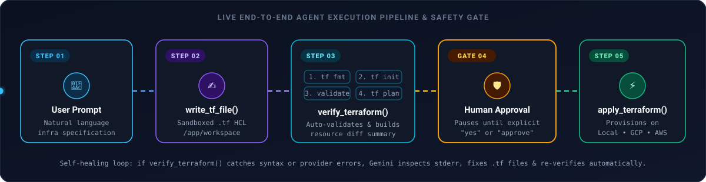
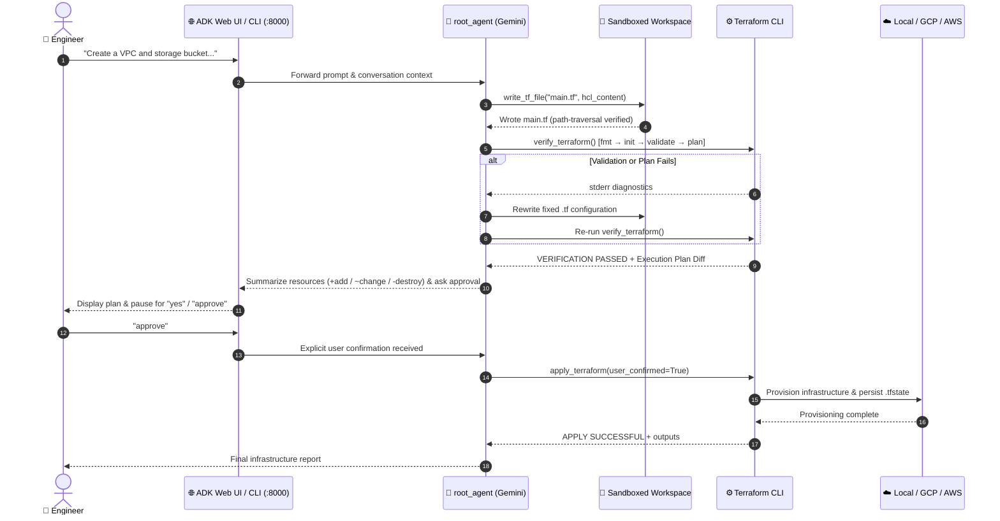

<a id="top"></a>

<div align="center">



<br />

<!-- TECH STACK BADGES -->
[](https://google.github.io/adk-docs/)
[](https://aistudio.google.com/)
[](https://developer.hashicorp.com/terraform)
[](https://www.docker.com/)
[](https://www.python.org/)

<!-- INTERACTIVE QUICK-NAVIGATION ACTION BUTTONS -->
### ⚡ Quick Navigation

[](#overview)
[](#architecture)
[](#project-structure)
[](#local-setup)
[](#gcp-setup)
[](#aws-setup)
[](#prompts)

</div>


<a id="overview"></a>

## 🧠 What Are We Doing in This Project?

Writing Terraform Infrastructure-as-Code (IaC) manually takes time, deep provider knowledge, and repetitive debugging cycles (`fmt` → `init` → `validate` → `plan`). On the flip side, letting an AI blindly execute `terraform apply` against production cloud accounts is **dangerous**.

**ADK Terraform Automation Agent** solves both problems by combining **autonomous AI code generation** with a **strict Human-in-the-Loop safety gate**:

| Problem Today | How This Project Solves It |
| :--- | :--- |
| 🐢 **Slow IaC authoring** across AWS, GCP, and local providers | 🤖 **Gemini + Google ADK** translates plain-English architecture requests into clean, modular `.tf` HCL files in seconds. |
| 💥 **Hallucinated or invalid Terraform syntax** | 🔍 **Automated Verification Loop** runs `terraform fmt`, `init`, `validate`, and `plan` automatically—and self-corrects errors before showing you results. |
| 🚨 **Risk of unapproved cloud changes or deletions** | 🛡️ **Mandatory Human Approval Gate** summarizes every resource addition/modification/deletion and blocks `terraform apply` until you explicitly reply `yes` or `approve`. |
| 🧩 **"Works on my machine" CLI version conflicts** | 🐳 **Dockerized Sandbox** bundles Python 3.12, Google ADK Web UI, and the official HashiCorp Terraform CLI with a restricted `/app/workspace` volume. |

<br />

<div align="center">
  
</div>


<a id="architecture"></a>

## ⚙️ How It Works — Architecture & Safety Pipeline

<div align="center">
  
</div>

### 🔄 Detailed Sequence Flow



### 🛡️ Built-in Security & Operational Guardrails

* **Workspace Jail (`_safe_path`)**: Every file write resolves paths against `WORKSPACE_DIR` (`/app/workspace`) and blocks path traversal (`../`) outside the sandbox.
* **Strict `.tf` File Filter**: `write_tf_file` only writes `.tf` Terraform configuration files—preventing arbitrary script or binary drops.
* **Subprocess Timeouts**: `verify_terraform` enforces a `180s` timeout per CLI stage and `apply_terraform` enforces a `300s` timeout so hung network/provider calls never freeze the container.
* **Two-Layer Approval Gate**: Both the system prompt instructions and the `if not user_confirmed:` Python check inside `apply_terraform()` prevent unconfirmed provisioning.

<div align="right">
  <a href="#top"></a>
</div>


<a id="project-structure"></a>

## 📂 Project Structure — Every File Explained

```text
terraform-adk-agent-main/
├── 📄 README.md                              # Complete visual guide, architecture & multi-cloud setup docs
├── 🙈 .gitignore                             # Root Git rules excluding .env secrets, .tfstate & Python caches
├── 🎨 assets/                                # Animated SVG diagrams & visual components for documentation
│   ├── hero-banner.svg                       # Animated neon hero banner & live command bar
│   ├── workflow-pipeline.svg                 # Animated 5-stage agent execution & approval pipeline
│   ├── terminal-demo.svg                     # Animated interactive session walkthrough
│   └── section-divider.svg                   # Animated gradient section divider
└── 📦 tf-automation-agent/                   # Dockerized ADK application root
    ├── 🐳 Dockerfile                         # Builds Python 3.12 + HashiCorp Terraform CLI + ADK Web server
    ├── 📋 requirements.txt                   # Python dependencies (google-adk>=1.0.0)
    ├── 🔐 .env                               # (You create this) Gemini API / Vertex AI & Cloud credentials
    ├── 🙈 .gitignore                         # App-level exclusions for local Terraform state & bytecode
    ├── 📁 workspace/                         # Sandboxed persistence directory mounted to /app/workspace
    │   └── .gitkeep                          # Keeps the empty workspace folder tracked in Git
    └── 🧠 terraform_agent/                   # Google ADK Python Agent package
        ├── __init__.py                       # Exports root_agent for automatic ADK CLI/Web discovery
        └── agent.py                          # Workspace sandbox, 3 Terraform tools & Gemini root_agent config
```

### 🔍 Deep Dive Into Each Core File

<details open>
<summary><b>1️⃣ <code>tf-automation-agent/terraform_agent/agent.py</code> — The Agent Brain & Tools</b> (Click to collapse/expand)</summary>
<br />

This is the core implementation file containing four components:

* **Workspace Initialization**: Resolves `WORKSPACE_DIR` (defaults to `/app/workspace` inside Docker, or falls back to `tf-automation-agent/workspace` locally) and ensures the folder exists.
* **`write_tf_file(filename, content)`**: Validates that `filename` ends with `.tf`, checks `_safe_path(filename)` to block directory traversal, creates subdirectories if needed, and writes UTF-8 HCL code.
* **`verify_terraform()`**: Runs four sequential CLI checks inside `WORKSPACE_DIR`:
  1. `terraform fmt -recursive` *(formats HCL cleanly)*
  2. `terraform init -input=false` *(downloads provider plugins)*
  3. `terraform validate` *(checks schema & syntax validity)*
  4. `terraform plan -input=false -no-color` *(calculates exact infrastructure diff)*
* **`apply_terraform(user_confirmed)`**: Aborts immediately if `user_confirmed` is `False`. When `True`, runs `terraform apply -auto-approve -input=false -no-color` and returns provisioning logs.
* **`root_agent`**: Instantiates `google.adk.agents.Agent` (model configurable via `MODEL_NAME`, defaulting to `gemini-2.0-flash`) with strict 5-step human-in-the-loop instructions.

</details>

<details>
<summary><b>2️⃣ <code>tf-automation-agent/terraform_agent/__init__.py</code> — ADK Discovery Entrypoint</b></summary>
<br />

Exports `from .agent import root_agent`. When you run `adk web` or `adk run terraform_agent` from `/app`, Google ADK scans subdirectories for Python packages exporting `root_agent` and automatically registers `terraform_agent` in the UI dropdown.

</details>

<details>
<summary><b>3️⃣ <code>tf-automation-agent/Dockerfile</code> — Reproducible Runtime Container</b></summary>
<br />

Starts from `python:3.12-slim`, installs `curl`, `gnupg`, `git`, and the official **HashiCorp Terraform CLI** from `apt.releases.hashicorp.com`, installs `requirements.txt`, copies `terraform_agent/`, prepares `/app/workspace`, exposes port `8000`, and launches:
```dockerfile
CMD ["adk", "web", "--host", "0.0.0.0", "--port", "8000"]
```

</details>

<details>
<summary><b>4️⃣ <code>tf-automation-agent/workspace/</code> — Persistent State Volume</b></summary>
<br />

Mounted from your host machine (`./workspace:/app/workspace`) when running in Docker. All generated `.tf` files, `.terraform.lock.hcl`, and `terraform.tfstate` live here so your infrastructure state survives container restarts—while `.gitignore` ensures state files and secrets are never committed to Git.

</details>

<div align="right">
  <a href="#top"></a>
</div>


<a id="local-setup"></a>

## 💻 Setup Guide 1: Local Machine (Docker or Native Python)

[-2496ED?style=for-the-badge&logo=docker&logoColor=white)](#local-docker)
[](#local-python)

### Prerequisites
* **Gemini API Key** from [Google AI Studio](https://aistudio.google.com/apikey)
* **Docker Desktop** *(for Option A)* **OR** **Python 3.12+ & [Terraform CLI](https://developer.hashicorp.com/terraform/install)** *(for Option B)*

---

<a id="local-docker"></a>
### 🐳 Option A: Run Locally with Docker (Recommended)

#### Step 1 — Create `tf-automation-agent/.env`
Navigate into `tf-automation-agent/` and create a `.env` file:

```env
# Gemini Model Configuration (Google AI Studio)
GOOGLE_GENAI_USE_VERTEXAI=FALSE
GOOGLE_API_KEY=your_gemini_api_key_here
MODEL_NAME=gemini-2.5-flash
```

#### Step 2 — Build the Container Image
```bash
cd tf-automation-agent
docker build -t adk-terraform-agent .
```

#### Step 3 — Launch the Agent Container

<details open>
<summary><b>🪟 Windows (PowerShell)</b></summary>

```powershell
docker run -it --rm `
  -p 8000:8000 `
  --env-file .env `
  -v "${PWD}/workspace:/app/workspace" `
  adk-terraform-agent
```
</details>

<details>
<summary><b>🍎 macOS / 🐧 Linux (Bash / Zsh)</b></summary>

```bash
docker run -it --rm \
  -p 8000:8000 \
  --env-file .env \
  -v "$(pwd)/workspace:/app/workspace" \
  adk-terraform-agent
```
</details>

#### Step 4 — Open the ADK Web Studio
Click below once the container is running:

[](http://localhost:8000)

Select **`terraform_agent`** in the top-left agent selector and test with zero cloud credentials needed:
> 💬 *"Use the Terraform `local` and `random` providers to generate a random 16-character deployment ID and write it to `deployment-id.txt`."*

---

<a id="local-python"></a>
### 🐍 Option B: Run Locally Without Docker (Native Python)

> [!IMPORTANT]
> **Windows Users:** Always set `WORKSPACE_DIR` explicitly when running outside Docker on Windows so Python writes to `./workspace` rather than `C:\app\workspace`.

```powershell
cd tf-automation-agent

# 1. Create and activate virtual environment
python -m venv .venv
# Windows PowerShell:
.\.venv\Scripts\Activate.ps1
# macOS / Linux:
# source .venv/bin/activate

# 2. Install Google ADK
pip install -r requirements.txt

# 3. Set workspace path (PowerShell example; use `export` on macOS/Linux)
$env:WORKSPACE_DIR = "$PWD\workspace"

# 4. Launch Web UI (http://localhost:8000) OR Interactive CLI
adk web --port 8000
# Or CLI mode:
# adk run terraform_agent
```

<div align="right">
  <a href="#top"></a>
</div>


<a id="gcp-setup"></a>

## ☁️ Setup Guide 2: Google Cloud Platform (GCP)

[](#gcp-provision)
[](#gcp-deploy)

<a id="gcp-provision"></a>
### Part 1: Configure the Agent to Provision GCP Infrastructure

#### 1. Authenticate with GCP & Create Service Account (or ADC)
```bash
# Authenticate gcloud CLI
gcloud auth login
gcloud config set project YOUR_GCP_PROJECT_ID

# Option 1 (Local Dev): Generate Application Default Credentials (ADC)
gcloud auth application-default login
```
*(Alternatively, create a Service Account with the IAM roles needed by your Terraform configs—such as `roles/storage.admin` or `roles/compute.admin`—and download `gcp-sa-key.json` outside the Git repo).*

#### 2. Configure `tf-automation-agent/.env` for GCP
You can power Gemini using **either** a Google AI Studio key **or** enterprise **Vertex AI**:

```env
# --- Option A: Use Vertex AI (No API key needed; uses GCP IAM!) ---
GOOGLE_GENAI_USE_VERTEXAI=TRUE
GOOGLE_CLOUD_PROJECT=your-gcp-project-id
GOOGLE_CLOUD_LOCATION=us-central1
MODEL_NAME=gemini-2.5-flash

# --- Terraform Google Provider Defaults ---
GOOGLE_PROJECT=your-gcp-project-id
GOOGLE_REGION=us-central1
```

#### 3. Run Docker with GCP Credentials Mounted

<details open>
<summary><b>🔑 Mounting a Service Account Key JSON</b></summary>

```bash
docker run -it --rm \
  -p 8000:8000 \
  --env-file .env \
  -e GOOGLE_APPLICATION_CREDENTIALS=/gcp/creds.json \
  -v "/absolute/path/to/gcp-sa-key.json:/gcp/creds.json:ro" \
  -v "$(pwd)/workspace:/app/workspace" \
  adk-terraform-agent
```
</details>

<details>
<summary><b>🪪 Mounting Local <code>gcloud</code> Application Default Credentials (ADC)</b></summary>

```bash
# Linux / macOS (~/.config/gcloud/application_default_credentials.json)
# Windows (%APPDATA%/gcloud/application_default_credentials.json)
docker run -it --rm \
  -p 8000:8000 \
  --env-file .env \
  -e GOOGLE_APPLICATION_CREDENTIALS=/gcp/adc.json \
  -v "$HOME/.config/gcloud/application_default_credentials.json:/gcp/adc.json:ro" \
  -v "$(pwd)/workspace:/app/workspace" \
  adk-terraform-agent
```
</details>

---

<a id="gcp-deploy"></a>
### Part 2: Deploy & Host the Agent on GCP (Cloud Run)

Want your whole team to access the ADK Terraform Agent via HTTPS on Google Cloud? Deploy the container directly to **Cloud Run**:

> [!TIP]
> **State Persistence on Cloud Run:** Because Cloud Run containers are ephemeral, mount a **Cloud Storage FUSE volume** onto `/app/workspace` (shown below) **or** instruct the agent in your prompts to include a `backend "gcs" { bucket = "..." }` block in `main.tf`!

```bash
cd tf-automation-agent

# 1. Enable required GCP APIs
gcloud services enable run.googleapis.com cloudbuild.googleapis.com aiplatform.googleapis.com storage.googleapis.com

# 2. Create a GCS bucket to persist /app/workspace (.tf files & state)
gcloud storage buckets create gs://YOUR_GCP_PROJECT_ID-tf-workspace --location=us-central1

# 3. Build & Deploy directly to Cloud Run with Vertex AI + GCS Volume Mount
gcloud run deploy adk-terraform-agent \
  --source . \
  --region us-central1 \
  --port 8000 \
  --memory 2Gi \
  --cpu 2 \
  --timeout 600 \
  --no-allow-unauthenticated \
  --set-env-vars="GOOGLE_GENAI_USE_VERTEXAI=TRUE,GOOGLE_CLOUD_PROJECT=YOUR_GCP_PROJECT_ID,GOOGLE_CLOUD_LOCATION=us-central1,MODEL_NAME=gemini-2.5-flash" \
  --add-volume=name=tf-workspace,type=cloud-storage,bucket=YOUR_GCP_PROJECT_ID-tf-workspace \
  --add-volume-mount=volume=tf-workspace,mount-path=/app/workspace
```

Access your private Cloud Run agent securely via IAM proxy:
```bash
gcloud run services proxy adk-terraform-agent --region us-central1 --port 8000
```

<div align="right">
  <a href="#top"></a>
</div>


<a id="aws-setup"></a>

## 🟧 Setup Guide 3: Amazon Web Services (AWS)

[](#aws-provision)
[-232F3E?style=for-the-badge&logo=amazonwebservices&logoColor=white)](#aws-deploy)

<a id="aws-provision"></a>
### Part 1: Configure the Agent to Provision AWS Infrastructure

#### 1. Configure `tf-automation-agent/.env` with AWS Credentials
```env
# Gemini API Key
GOOGLE_GENAI_USE_VERTEXAI=FALSE
GOOGLE_API_KEY=your_gemini_api_key_here
MODEL_NAME=gemini-2.5-flash

# AWS Provider Credentials (or mount ~/.aws below instead)
AWS_ACCESS_KEY_ID=AKIA...
AWS_SECRET_ACCESS_KEY=your_aws_secret_key
AWS_DEFAULT_REGION=us-east-1
# Optional if using temporary STS / SSO session tokens:
# AWS_SESSION_TOKEN=...
```

#### 2. Run the Container (Env Keys OR Mounted `~/.aws` Profile)

<details open>
<summary><b>🔑 Using <code>.env</code> Credentials</b></summary>

```bash
cd tf-automation-agent
docker run -it --rm \
  -p 8000:8000 \
  --env-file .env \
  -v "$(pwd)/workspace:/app/workspace" \
  adk-terraform-agent
```
</details>

<details>
<summary><b>🛡️ Using AWS SSO / Named Profile (<code>~/.aws</code> Read-Only Mount)</b></summary>

```bash
docker run -it --rm \
  -p 8000:8000 \
  --env-file .env \
  -e AWS_PROFILE=your-profile-name \
  -e AWS_SDK_LOAD_CONFIG=1 \
  -v "$HOME/.aws:/root/.aws:ro" \
  -v "$(pwd)/workspace:/app/workspace" \
  adk-terraform-agent
```
</details>

---

<a id="aws-deploy"></a>
### Part 2: Deploy & Host the Agent on AWS (ECR + EC2 / ECS)

#### Step 1 — Push Image to Amazon ECR
```bash
cd tf-automation-agent
export AWS_REGION=us-east-1
export AWS_ACCOUNT_ID=$(aws sts get-caller-identity --query Account --output text)

# 1. Create ECR repository
aws ecr create-repository --repository-name adk-terraform-agent --region $AWS_REGION

# 2. Authenticate Docker to ECR
aws ecr get-login-password --region $AWS_REGION | \
  docker login --username AWS --password-stdin $AWS_ACCOUNT_ID.dkr.ecr.$AWS_REGION.amazonaws.com

# 3. Build, tag & push image
docker build -t adk-terraform-agent .
docker tag adk-terraform-agent:latest $AWS_ACCOUNT_ID.dkr.ecr.$AWS_REGION.amazonaws.com/adk-terraform-agent:latest
docker push $AWS_ACCOUNT_ID.dkr.ecr.$AWS_REGION.amazonaws.com/adk-terraform-agent:latest
```

#### Step 2 — Run on an EC2 Instance (with IAM Instance Profile & Persistent EBS Workspace)

> [!NOTE]
> Attaching an **IAM Role (Instance Profile)** to your EC2 host or ECS Task Role lets Terraform provision AWS resources **without storing any static `AWS_ACCESS_KEY_ID` secrets**! Terraform automatically discovers EC2/ECS metadata credentials.

```bash
# On your Amazon Linux 2023 / Ubuntu EC2 instance:
mkdir -p ~/tf-workspace

# Store Gemini API key securely (or pull from AWS Secrets Manager / SSM)
cat <<EOF > ~/.agent.env
GOOGLE_GENAI_USE_VERTEXAI=FALSE
GOOGLE_API_KEY=your_gemini_api_key_here
MODEL_NAME=gemini-2.5-flash
AWS_DEFAULT_REGION=us-east-1
EOF

# Pull from ECR & run detached with automatic restart and persistent EBS volume
docker run -d --name adk-terraform-agent \
  --restart unless-stopped \
  -p 8000:8000 \
  --env-file ~/.agent.env \
  -v "$HOME/tf-workspace:/app/workspace" \
  $AWS_ACCOUNT_ID.dkr.ecr.$AWS_REGION.amazonaws.com/adk-terraform-agent:latest
```
*(For **ECS Fargate**, mount an **Amazon EFS** filesystem to `/app/workspace` or instruct the agent to configure `backend "s3"` in Terraform so state persists in S3 + DynamoDB locking).*

<div align="right">
  <a href="#top"></a>
</div>


<a id="prompts"></a>

## 🚀 Ready-to-Use Example Prompts

Click any target environment below to copy a test prompt into the ADK Web UI:

<details open>
<summary><b>💻 Local Zero-Cloud Test Prompt (No AWS/GCP Account Needed)</b></summary>

```text
Create a Terraform configuration using the hashicorp/random and hashicorp/local providers that generates a random pet name and writes a JSON manifest file inside the workspace with the generated ID and timestamp. Run verification and show me the plan.
```
</details>

<details>
<summary><b>☁️ Google Cloud (GCP) Infrastructure Prompt</b></summary>

```text
Write modular Terraform files (providers.tf, variables.tf, main.tf, outputs.tf) for GCP in project "my-gcp-project" (us-central1) that creates a private Google Cloud Storage bucket with uniform bucket-level access, object versioning enabled, and a 30-day lifecycle rule to transition objects to Nearline storage. Verify the plan and wait for my approval.
```
</details>

<details>
<summary><b>🟧 Amazon Web Services (AWS) Infrastructure Prompt</b></summary>

```text
Generate Terraform code (providers.tf, main.tf, variables.tf, outputs.tf) in us-east-1 to provision a VPC (10.0.0.0/16) with two public subnets across two availability zones, an Internet Gateway, route table associations, and a locked-down S3 bucket with server-side AES256 encryption and public access blocked. Verify and show me the plan summary first.
```
</details>

---

## 🛠️ Troubleshooting & FAQ

<details>
<summary><b>❓ <code>Terraform CLI not found</code> when running locally</b></summary>
<br />

If running outside Docker (`adk web` / `adk run`), install Terraform and verify `terraform -version` works in your terminal, or use the **Docker** setup which pre-installs HashiCorp Terraform automatically.
</details>

<details>
<summary><b>❓ Files appear in <code>C:\app\workspace</code> on Windows</b></summary>
<br />

When running natively on Windows without Docker, set `$env:WORKSPACE_DIR = "$PWD\workspace"` before launching `adk web` so `agent.py` uses your project's `workspace/` folder.
</details>

<details>
<summary><b>❓ Changing the Gemini Model (e.g., Gemini 2.5 Pro or Flash)</b></summary>
<br />

Set `MODEL_NAME=gemini-2.5-pro` (or `gemini-2.5-flash`) in `tf-automation-agent/.env`. `agent.py` dynamically reads `os.getenv("MODEL_NAME", "gemini-2.0-flash")` at startup.
</details>

<br />

<div align="center">


### Built with ❤️ using **Google ADK**, **Gemini**, **Terraform**, and **Docker**

[](#top)

</div>
